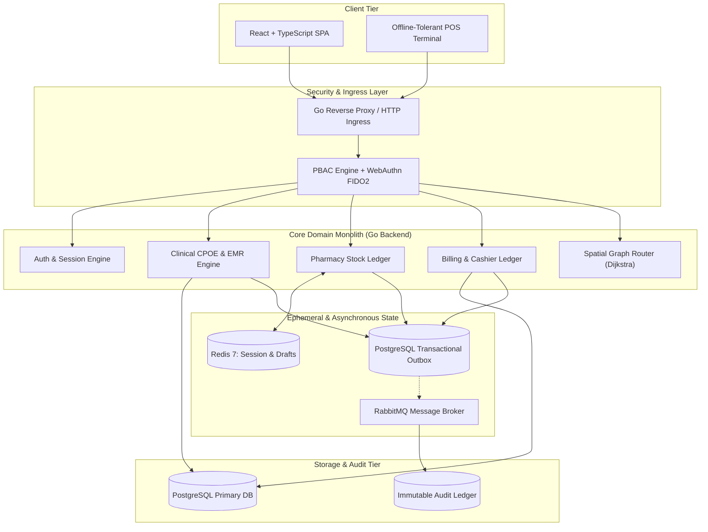

# Haris Pratama — Systems & Backend Engineer

[-gray?style=flat)]()

Backend & Systems Engineer specializing in **high-integrity distributed architectures**, **modular monoliths in Go**, and **deterministic transactional pipelines**. 

I engineer mission-critical systems designed around zero data corruption, strict concurrency guarantees, and scalable relational database boundaries.

---

## 🏛️ Flagship Case Study: AisHealth Enterprise

A production-grade Healthcare ERP, Hospital Information System (SIMRS), and Casemix Ledger built single-handedly from scratch.

* **Architecture Paradigm:** Clean Architecture Modular Monolith
* **Core Stack:** Go (Golang), PostgreSQL, Redis, RabbitMQ, TypeScript, React
* **System Footprint:** 46 relational domain schemas, 100+ service/repo boundaries, and 62 audited end-to-end API transaction chains.

---

## ⚙️ Core Technical Decisions & Engineering Trade-offs

### 1. Modular Monolith over Distributed Microservices
* **The Decision:** Rejected premature microservice fragmentation in favor of strict domain boundaries within a single Go module.
* **The Impact:** Avoided distributed two-phase commit overhead and network serialization latencies while maintaining sub-millisecond query execution. Reduced operational hosting overhead by over 60% without compromising logical separation of concerns.

### 2. Transactional Outbox Pattern with RabbitMQ
* **The Problem:** Preventing dual-write discrepancies between relational database state changes (e.g., patient admission, inventory dispensing, invoice generation) and asynchronous external notification listeners.
* **The Solution:** Wrapped event record insertions directly inside the primary PostgreSQL transaction table (`models.OutboxEvent`). A dedicated Go worker polls and dispatches uncommitted events to RabbitMQ queues with exponential backoff and dead-letter handling.
* **The Result:** 100% at-least-once delivery guarantee across all billing updates and clinical alerts.

### 3. Deterministic Integer Arithmetic (Zero IEEE-754 Drift)
* **The Problem:** Standard floating-point arithmetic introduces fractional rounding errors across multi-tiered pricing, progressive tax deductions, and regional pharmacy margin calculations.
* **The Solution:** Implemented a zero-float policy across all financial engines (`accounting.go`, `tarif.go`, `payroll_engine.go`). All currency mutations, inventory valuation (FIFO), and tariff components are computed using scaled integer representations.

### 4. Policy-Based Access Control (PBAC) & Biometric Auth
* **The Architecture:** Custom PBAC gate evaluating hierarchical permissions per operation (`MANAGE_SYSTEM`, `READ_PHARMACY_QUEUE`, `UPDATE_MEDICAL_RECORD`).
* **Authentication:** Multi-session token rotation coupled with WebAuthn FIDO2 biometric authentication and hash-verified offline PIN verification for fast nurse/pharmacist workstation sign-offs.

### 5. Spatial Indoor Hospital Routing Engine
* **The Implementation:** Modeled hospital hallway topologies as topological graphs using `models.HallwayNode` and `models.HallwayEdge`. Integrated pathfinding algorithms to compute optimal routing distances between emergency wards, operating rooms, and pharmacy depots.

---

## 🛠️ Specialized Tooling

### AST-Level Architecture Graph Auditor (Python)
To maintain structural compliance across 100+ backend Go packages and React routes, I engineered a custom AST dependency parser and blueprint visualizer:
* Statically traces frontend API clients (`api/*.ts`) down to Go HTTP Handlers, business logic services, transactional repositories, and GORM database models.
* Automatically exports Single-Source-of-Truth (SSOT) architecture dossiers for auditability, dependency cycle detection, and structured LLM tool-calling contexts.

---

## 💻 Tech Stack Summary

| Domain | Technologies |
| :--- | :--- |
| **Backend & Concurrency** | Go (Golang), Gorilla/Chi/Gin patterns, Goroutines, Channels |
| **Data Persistence** | PostgreSQL (Multi-Schema, Index Tuning, Partitioning, GORM) |
| **Caching & Messaging** | Redis 7 (In-Memory Queues & Drafts), RabbitMQ (Outbox Pattern) |
| **Frontend Architecture** | TypeScript, React, Vite, Tailwind CSS, Zod Validation |
| **Security & Protocols** | WebAuthn FIDO2, PBAC/RBAC, WebSockets, Dynamic QRIS/Payment APIs |
| **Internal Tooling** | Python (AST Parsers, Codebase Auditors, Pipeline Automation) |

---

## 📹 System Architecture Walkthrough

For a dense, 5-minute technical demonstration showcasing the live platform, state boundaries, and schema architecture:

👉 **[Watch the 5-Minute AisHealth Enterprise Walkthrough on YouTube](https://youtu.be/iMKNz35sLt8)**

---

## 📬 Contact & Availability

* **Status:** Available for full-time remote Backend / Systems roles
* **Timezone:** UTC+7 (Pekanbaru, Indonesia) — comfortably overlapping with US, EMEA, and APAC working hours
* **Email:** aisharis@proton.me
* **LinkedIn:** [linkedin.com/in/haris-pratama-dev](https://www.linkedin.com/in/haris-pratama-dev/)
